#  Hypercube

<a href="https://hypercube.adsm.dev/"></a>

Games, visualisations and interactive learning pieces for large multi-touch installations: rows of portrait touch panels under projectors, wide touch walls, kiosks and spherical displays. Each display loads one page of a static, frontend-only site that runs from any static host with no backend of its own. Pages that play together connect peer-to-peer with WebRTC, using a PeerJS broker only to find each other.

Live site: https://hypercube.adsm.dev/

- `/` lists the pieces and builds the URL for each display.
- `/play/?app=<id>` runs a piece. Add `fit=1080x1920` to preview a portrait panel on a phone or laptop.
- `/sim/` simulates a whole installation in one browser tab.

## Pieces

Each title links to the piece's page on the site, which shows a live preview and builds the URLs to set it up. The last column lists the kinds of display it runs on:

- panel: a portrait touch panel
- pair: two panels side by side, used as one surface
- wall: a wide touch wall
- kiosk: a landscape touch screen
- screen: a large display above a row of panels, which nobody touches
- sphere: a spherical display

<!-- pieces:start -->

### Games

|                                                                                                                                | Piece                                                       | What it does                                                                                                 | Runs on                          |
| ------------------------------------------------------------------------------------------------------------------------------ | ----------------------------------------------------------- | ------------------------------------------------------------------------------------------------------------ | -------------------------------- |
| [](https://hypercube.adsm.dev/#/bluebottle) | [Bluebottle Beach](https://hypercube.adsm.dev/#/bluebottle) | Dig the sand together and work out where the bluebottles hide from the numbers, with no guessing needed.     | panel, pair, wall, screen        |
| [](https://hypercube.adsm.dev/#/skyline)          | [Crane Skyline](https://hypercube.adsm.dev/#/skyline)       | Send blocks to the yard and swing them up with a tower crane to build a skyline.                             | panel, pair, wall, kiosk, screen |
| [](https://hypercube.adsm.dev/#/manyhands)         | [Many Hands](https://hypercube.adsm.dev/#/manyhands)        | Quick tasks on every panel make parts for one big build that always gets finished.                           | panel, pair, wall, screen        |
| [](https://hypercube.adsm.dev/#/pinball)                | [Pinball](https://hypercube.adsm.dev/#/pinball)             | Flippers low for children, flippers high for grown-ups, and deck shots fly up to the screen.                 | panel, pair, wall, screen        |
| [](https://hypercube.adsm.dev/#/recycling)     | [Recycling Rush](https://hypercube.adsm.dev/#/recycling)    | Grab rubbish off the belts and throw it in the right bin; full bins build a park.                            | panel, pair, wall, kiosk, screen |
| [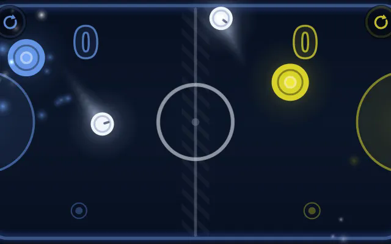](https://hypercube.adsm.dev/#/hockey)             | [Table Hockey](https://hypercube.adsm.dev/#/hockey)         | Knock pucks into the other side's goal with a mallet that follows your finger.                               | panel, pair, wall, kiosk, screen |
| [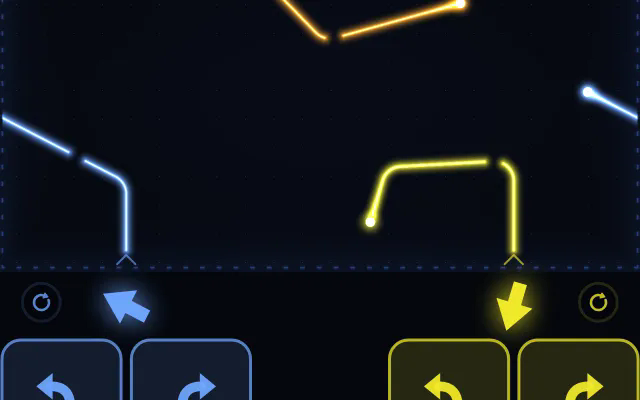](https://hypercube.adsm.dev/#/tangle)                   | [Tangle](https://hypercube.adsm.dev/#/tangle)               | Steer a glowing line and stay off every trail. The last line moving wins.                                    | panel, pair, wall, screen        |
| [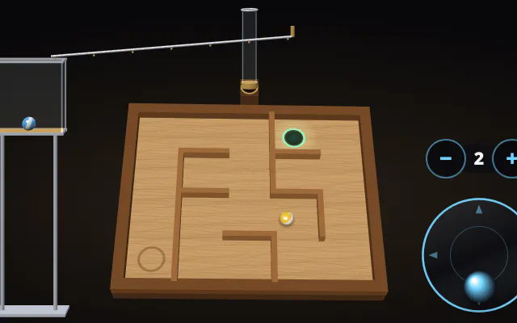](https://hypercube.adsm.dev/#/tiltmaze)            | [Tilt Maze](https://hypercube.adsm.dev/#/tiltmaze)          | Tip a wooden maze with a big pad and roll the ball into the goal; finished balls shoot up into a marble run. | panel, pair, wall, kiosk, screen |
| [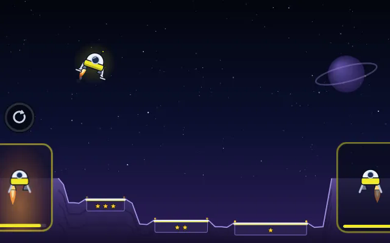](https://hypercube.adsm.dev/#/touchdown)          | [Touchdown](https://hypercube.adsm.dev/#/touchdown)         | Two people, one engine each: work together to set a little spacecraft down on a pad.                         | panel, pair, wall, kiosk, screen |
| [](https://hypercube.adsm.dev/#/treetop)           | [Treetop Race](https://hypercube.adsm.dev/#/treetop)        | Tap to fly through the gaps and race everyone else on the same course.                                       | panel, pair, wall, screen        |

### Visualisations and learning pieces

|                                                                                                                           | Piece                                                      | What it does                                                                                                                                       | Runs on                          |
| ------------------------------------------------------------------------------------------------------------------------- | ---------------------------------------------------------- | -------------------------------------------------------------------------------------------------------------------------------------------------- | -------------------------------- |
| [](https://hypercube.adsm.dev/#/airflow)           | [Airflow](https://hypercube.adsm.dev/#/airflow)            | Put a wing, a car or a bird in a stream of smoke, turn it and change the wind, and watch the air part, swirl and shed eddies.                      | panel, pair, wall, kiosk, screen |
| [](https://hypercube.adsm.dev/#/answerball) | [Answer Ball](https://hypercube.adsm.dev/#/answerball)     | A giant answer ball: it rocks, and in its windows a die rises out of dark liquid with an answer. On a wall, touch a ball to shake it.              | wall, sphere                     |
| [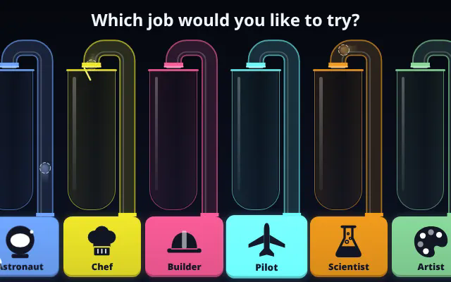](https://hypercube.adsm.dev/#/ballpit)     | [Ball Pit Poll](https://hypercube.adsm.dev/#/ballpit)      | Answer a picture question and watch your ball whoosh up a pipe into its tube.                                                                      | panel, pair, wall, kiosk, screen |
| [](https://hypercube.adsm.dev/#/beachball)    | [Beach Ball](https://hypercube.adsm.dev/#/beachball)       | A sphere becomes a lazily spinning beach ball; on a wall, bat and throw beach balls and toys round a beach with an umbrella and a crab.            | wall, sphere                     |
| [](https://hypercube.adsm.dev/#/gaze)                 | [Big Eye](https://hypercube.adsm.dev/#/gaze)               | A realistic eye that darts glances round the room, at people below and level with it, and on a wall turns to whoever touches.                      | wall, sphere                     |
| [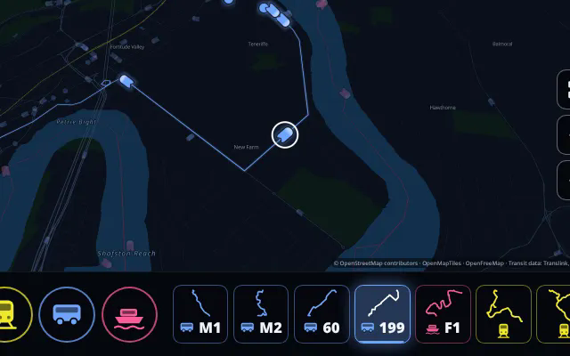](https://hypercube.adsm.dev/#/transit)  | [Brisbane Transit](https://hypercube.adsm.dev/#/transit)   | Every bus, train and ferry in inner Brisbane moving on a live map. Light up a mode, follow a route, or drag and zoom the map.                      | wall, kiosk, screen              |
| [](https://hypercube.adsm.dev/#/cake)                    | [Cake](https://hypercube.adsm.dev/#/cake)                  | The whole ball is a round cake under a glossy glaze: a Christmas pudding or one of four others.                                                    | sphere                           |
| [](https://hypercube.adsm.dev/#/chladni)     | [Chladni Plate](https://hypercube.adsm.dev/#/chladni)      | Ring a sand-covered plate, move where it is shaken, stretch or damp it, and watch the sand find the still lines.                                   | panel, pair, wall, kiosk, screen |
| [](https://hypercube.adsm.dev/#/claw)            | [Claw Machine](https://hypercube.adsm.dev/#/claw)          | Claw machines that play themselves round the ball, or stand in a row on a wall for anyone to have a go.                                            | wall, sphere                     |
| [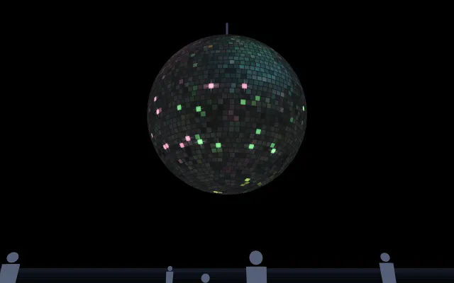](https://hypercube.adsm.dev/#/discoball)    | [Disco Ball](https://hypercube.adsm.dev/#/discoball)       | The ball becomes a mirror ball, turning slowly and sparkling with spotlights.                                                                      | sphere                           |
| [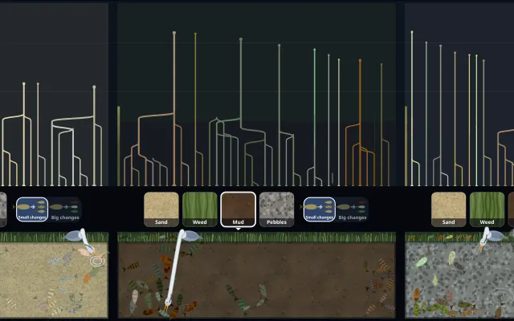](https://hypercube.adsm.dev/#/evolution)     | [Evolution](https://hypercube.adsm.dev/#/evolution)        | Catch the fish you can see. The hidden ones live to breed, and their family tree grows above the pond.                                             | panel, pair, wall, screen        |
| [](https://hypercube.adsm.dev/#/eye)                   | [Eye Lab](https://hypercube.adsm.dev/#/eye)                | Change an eye's length, curve, age and light, see where light focuses and how a scene looks through it.                                            | panel, pair, wall, kiosk, screen |
| [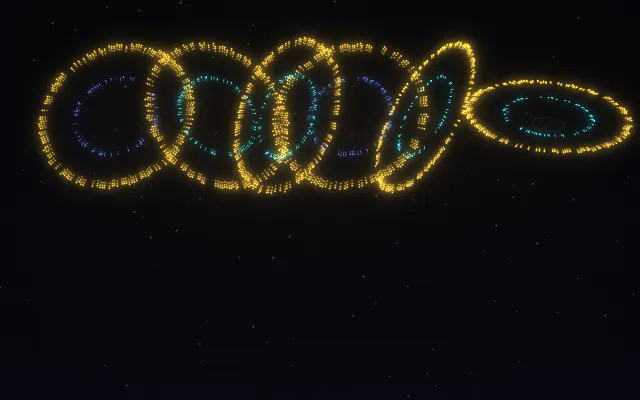](https://hypercube.adsm.dev/#/fireworks)     | [Fireworks](https://hypercube.adsm.dev/#/fireworks)        | Build a firework shell, send it up and watch it burst in the sky above.                                                                            | panel, pair, wall, screen        |
| [](https://hypercube.adsm.dev/#/fishbowl)       | [Fish Bowl](https://hypercube.adsm.dev/#/fishbowl)         | A planted tank of fish, shrimp and snails behind the wall's glass, or the ball as a glass bowl of water with funny fish that come up to the glass. | wall, sphere                     |
| [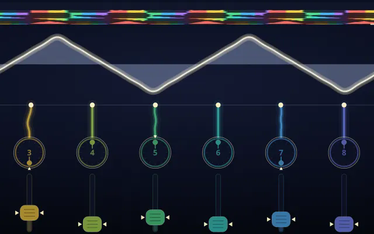](https://hypercube.adsm.dev/#/loom)            | [Fourier Loom](https://hypercube.adsm.dev/#/loom)          | Each slider and dial sets one sine wave; together they weave any shape.                                                                            | panel, pair, wall, kiosk, screen |
| [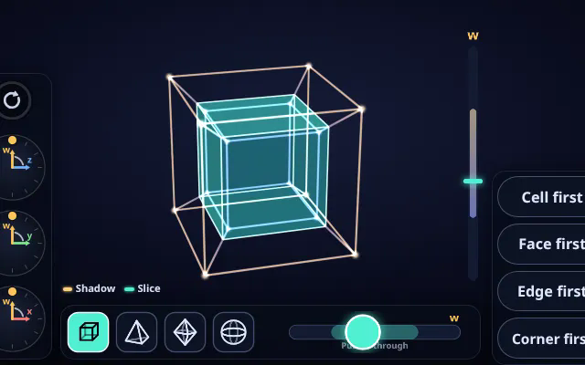](https://hypercube.adsm.dev/#/fourd)      | [Fourth Dimension](https://hypercube.adsm.dev/#/fourd)     | Push a 4D shape through our space and watch its slice grow, change and vanish.                                                                     | panel, pair, wall, kiosk, screen |
| [](https://hypercube.adsm.dev/#/gravity)   | [Gravity Sandbox](https://hypercube.adsm.dev/#/gravity)    | Fling rocks, planets, gas giants and stars into a universe where everything pulls on everything else.                                              | panel, pair, wall, kiosk, screen |
| [](https://hypercube.adsm.dev/#/hatch)          | [Hatching Egg](https://hypercube.adsm.dev/#/hatch)         | The ball is a hen's egg: it rocks, cracks round and opens, and a fluffy chick looks about.                                                         | sphere                           |
| [](https://hypercube.adsm.dev/#/kaleido)         | [Ink Mural](https://hypercube.adsm.dev/#/kaleido)          | Pour warm ink that billows up the wall and settles into a layer for each hour, or steer a kaleidoscope with your hands.                            | panel, pair, wall, screen        |
| [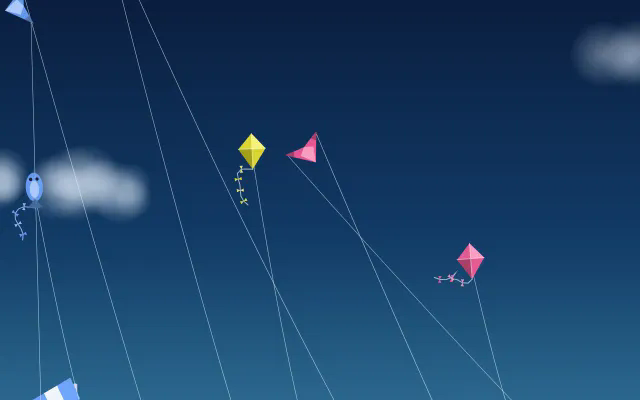](https://hypercube.adsm.dev/#/kites)                 | [Kites](https://hypercube.adsm.dev/#/kites)                | Hold a spool to send a kite climbing, or steer a stunt kite through rings on the breeze.                                                           | panel, pair, wall, screen        |
| [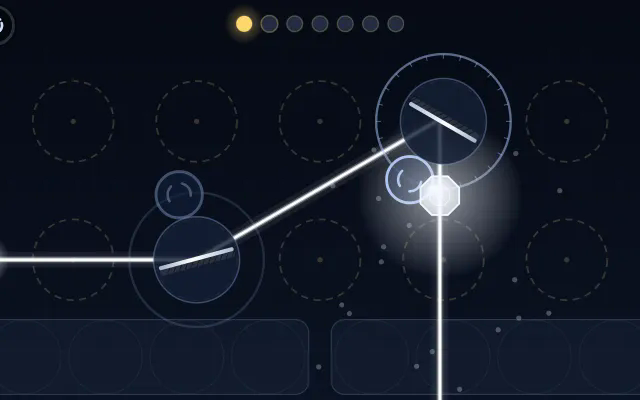](https://hypercube.adsm.dev/#/optics)         | [Light Bench](https://hypercube.adsm.dev/#/optics)         | Place mirrors, prisms and lenses and turn them to steer beams of light into the crystals.                                                          | panel, pair, wall, kiosk, screen |
| [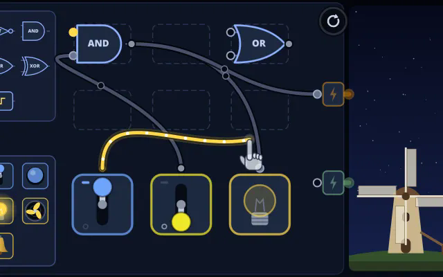](https://hypercube.adsm.dev/#/logic)             | [Logic Lab](https://hypercube.adsm.dev/#/logic)            | Flip big switches to light lamps, then wire logic gates between them to run a machine up on the wall.                                              | pair, wall, kiosk                |
| [](https://hypercube.adsm.dev/#/graphs)      | [Network Graphs](https://hypercube.adsm.dev/#/graphs)      | Explore a network: tap a node to see what it connects to.                                                                                          | panel, pair, wall, kiosk, screen |
| [](https://hypercube.adsm.dev/#/petri)            | [Petri Dish](https://hypercube.adsm.dev/#/petri)           | Seed a living culture with gliders, slime mould spores or drops of reagent and watch it grow.                                                      | panel, pair, wall, screen        |
| [](https://hypercube.adsm.dev/#/robotarm)       | [Robot Arm](https://hypercube.adsm.dev/#/robotarm)         | Turn one dial per joint to swing a six-axis arm, grab a block and put it down.                                                                     | panel, pair, wall, kiosk, screen |
| [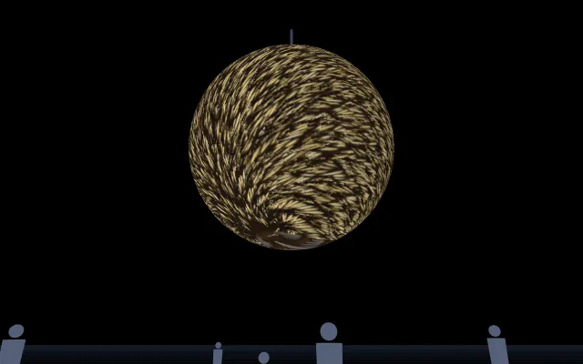](https://hypercube.adsm.dev/#/echidna)  | [Sleeping Echidna](https://hypercube.adsm.dev/#/echidna)   | The whole ball is an echidna curled up asleep, breathing slowly and twitching now and then.                                                        | sphere                           |
| [](https://hypercube.adsm.dev/#/snowglobe)    | [Snow Globe](https://hypercube.adsm.dev/#/snowglobe)       | The ball is a giant snow globe: a little winter scene inside, snow drifting down, and a shake every minute or two.                                 | sphere                           |
| [](https://hypercube.adsm.dev/#/orrery) | [Sun, Earth and Moon](https://hypercube.adsm.dev/#/orrery) | Carry the Earth round the Sun and watch the seasons, or the Moon round the Earth.                                                                  | panel, pair, wall, kiosk, screen |
| [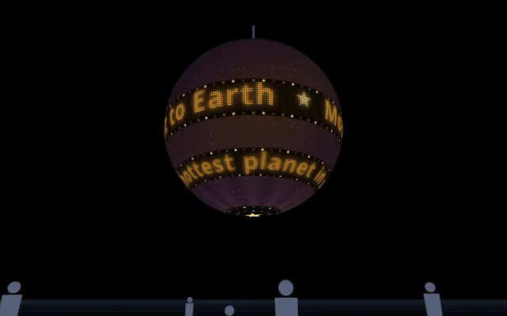](https://hypercube.adsm.dev/#/ticker)         | [Ticker Ring](https://hypercube.adsm.dev/#/ticker)         | Rings of bright lettering crawl round the ball, so everyone round it can read them.                                                                | sphere                           |
| [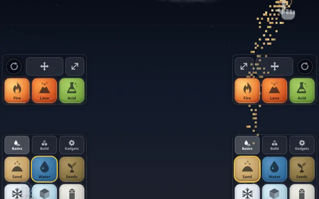](https://hypercube.adsm.dev/#/tinyworld)    | [Tiny World](https://hypercube.adsm.dev/#/tinyworld)       | Pour sand, water, seeds, fire and lava from your fingertips and watch them fall, flow and grow.                                                    | panel, pair, wall, screen        |
| [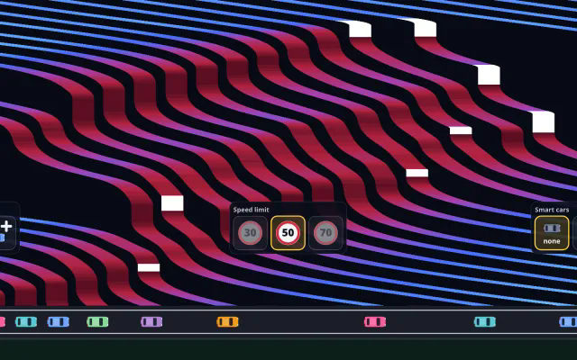](https://hypercube.adsm.dev/#/traffic)           | [Traffic](https://hypercube.adsm.dev/#/traffic)            | Touch a car to brake it and watch the jam you made travel backwards round the ring.                                                                | panel, pair, wall, screen        |
| [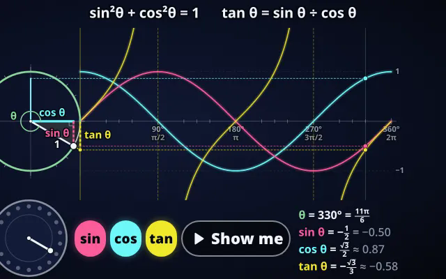](https://hypercube.adsm.dev/#/trig)             | [Unit Circle](https://hypercube.adsm.dev/#/trig)           | Turn a point round a circle and watch sin, cos and tan grow out of it.                                                                             | panel, pair, wall, kiosk, screen |
| [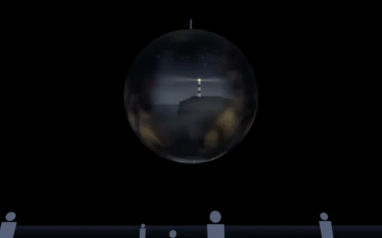](https://hypercube.adsm.dev/#/orb)                | [Vision Orb](https://hypercube.adsm.dev/#/orb)             | The ball becomes a dark glass orb full of swirling smoke, where now and then a faraway place clears and fades.                                     | sphere                           |
| [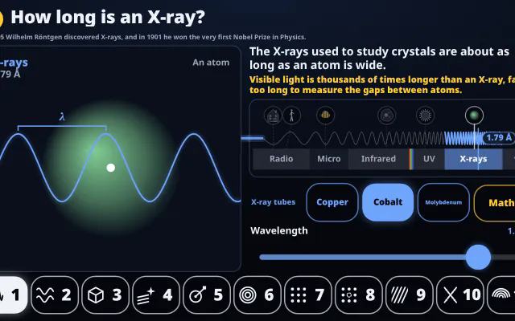](https://hypercube.adsm.dev/#/xrd)         | [X-Ray Diffraction](https://hypercube.adsm.dev/#/xrd)      | An interactive poster in eleven chapters on how X-rays show us the atoms inside a crystal.                                                         | panel, pair, wall, kiosk, screen |

<!-- pieces:end -->

## Development

```
pnpm install
pnpm dev
```

See `AGENTS.md` for the layout, URL parameters and how to write a piece.

## Libraries

Hypercube uses a few libraries at runtime:

- [PeerJS](https://peerjs.com/) for WebRTC connections between displays
- [three.js](https://threejs.org/) for the 3D pieces
- [planck.js](https://piqnt.com/planck.js/) for the claw machine's physics
- [MapLibre GL JS](https://maplibre.org/) for the transit map
- [uqr](https://github.com/unjs/uqr) for QR codes in the simulator

Everything else is written for this project: the pieces with their physics and simulations, the rendering, the networking on top of PeerJS (rooms, a relay hub and a shared clock) and the runtime that every display loads.

## Licence and credits

Hypercube's code is under the MIT licence (`LICENSE`). The build writes the licences of every library it bundles to `third-party-licenses.txt`, which the site serves and links from its footer.

- Brisbane Transit's route shapes and recorded vehicle positions in `src/apps/transit/data/` are adapted from [Translink's open data](https://www.translink.com.au/about-translink/open-data) under [CC BY 4.0](https://creativecommons.org/licenses/by/4.0/): simplified to route ids, shapes and positions.
- The transit map shows [OpenFreeMap](https://openfreemap.org/) tiles in the [OpenMapTiles](https://openmaptiles.org/) schema, built from data © [OpenStreetMap](https://www.openstreetmap.org/copyright) contributors. The app shows this credit on the map, and so do its screenshots here.
